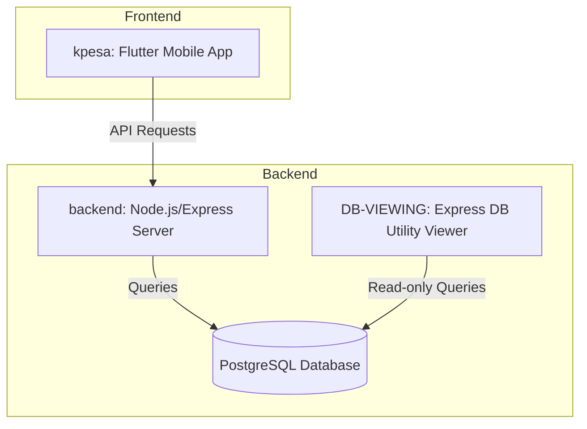
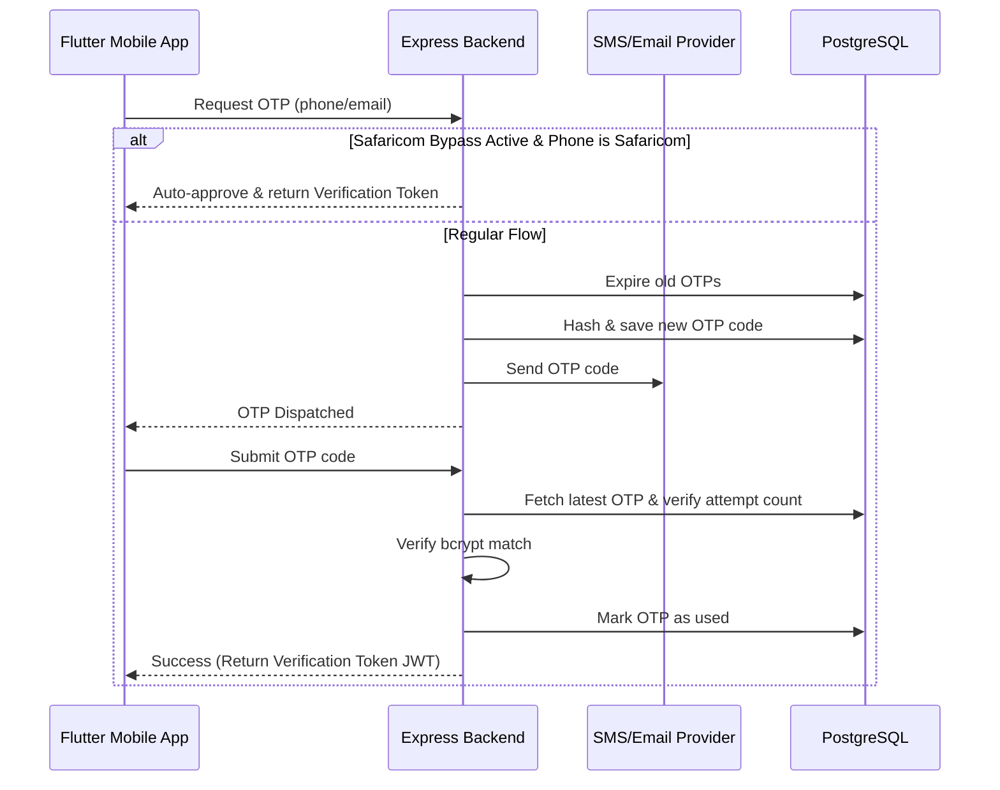

# Workspace Memory & Architecture (heart.md)

## Architecture Overview

This workspace contains the source code for K-PESA, a biometric-enabled financial and payment integration system, including a Flutter mobile application, an Express/PostgreSQL backend, and database utility viewer tools.

### Main Directories & Files
* **[backend](file:///C:/Users/Georges%20Mars/Documents/personal%20projects/k-pesa%20v2/backend)**: The Node.js Express server.
  * **[backend/src/app.js](file:///C:/Users/Georges%20Mars/Documents/personal%20projects/k-pesa%20v2/backend/src/app.js)**: Configures routes, middleware (rate limiting, error handler, CORS), and global security (Helmet).
  * **[backend/src/routes](file:///C:/Users/Georges%20Mars/Documents/personal%20projects/k-pesa%20v2/backend/src/routes)**: API routes: auth, OTP, user, deposit, withdraw, deriv, callbacks, and biometric authentication.
  * **[backend/src/services](file:///C:/Users/Georges%20Mars/Documents/personal%20projects/k-pesa%20v2/backend/src/services)**: Services for business logic:
    * **[otp.service.js](file:///C:/Users/Georges%20Mars/Documents/personal%20projects/k-pesa%20v2/backend/src/services/otp.service.js)**: Manages generation, verification, and temporary Safaricom bypass logic.
  * **[backend/migrations](file:///C:/Users/Georges%20Mars/Documents/personal%20projects/k-pesa%20v2/backend/migrations)**: SQL migration files for setting up tables (users, payment methods, otps, transactions, encrypt keys, etc.).
* **[kpesa](file:///C:/Users/Georges%20Mars/Documents/personal%20projects/k-pesa%20v2/kpesa)**: The Flutter mobile application.
  * **[kpesa/lib/main.dart](file:///C:/Users/Georges%20Mars/Documents/personal%20projects/k-pesa%20v2/kpesa/lib/main.dart)**: Initializer, theme switching (dark/light default dark), and deep link handler using `app_links` to catch `kpesa://deriv-callback`.
  * **[kpesa/lib/screens](file:///C:/Users/Georges%20Mars/Documents/personal%20projects/k-pesa%20v2/kpesa/lib/screens)**: User interfaces for signup, login, deposit, withdraw, OTP verification, profile, and affiliate system.
* **[DB-VIEWING](file:///C:/Users/Georges%20Mars/Documents/personal%20projects/k-pesa%20v2/DB-VIEWING)**: Local web utility running on port 5050 to inspect PostgreSQL database tables.
* **[SAFARICOM_OTP_REENABLE_CHECKLIST.txt](file:///C:/Users/Georges%20Mars/Documents/personal%20projects/k-pesa%20v2/SAFARICOM_OTP_REENABLE_CHECKLIST.txt)**: Action plan & checklist to restore normal OTP behaviour once the Safaricom SMS Sender ID is approved.

---

## System Flow

### 1. User Signup & OTP Verification

### 2. Deriv Integration & Deep Linking
* When completing auth or account linkages on Deriv, the user is redirected via the custom URL scheme `kpesa://deriv-callback`.
* `main.dart` listens to deep link stream (`uriLinkStream` and `getInitialLink`). When it matches `kpesa://deriv-callback`, it navigates the user directly to `SignUpPage` with the callback URI parameters to perform OAuth linking.

---

## History of Changes

* **2026-06-14**: Initial codebase scanning. Mapping the Flutter project directories, Node.js backend structure, and DB viewing utility. Created initial `heart.md` file.
* **2026-06-14**: Added `BYPASS_SAFARICOM_OTP` environment variable support to backend. Replaced hardcoded bypass in `otp.service.js` with dynamic environment variable checking. Updated `.env`, `.env.example`, and `src/config/env.js`.
* **2026-06-14**: Fixed biometric login and enrollment by creating the missing database migration `010_create_device_biometrics.sql`, updating `MainActivity.kt` on Android to inherit from `FlutterFragmentActivity`, and adding `NSFaceIDUsageDescription` to `Info.plist` on iOS. Cleaned up duplicate manual migration file `add_encryption_columns.sql` to avoid key conflicts.
* **2026-06-14**: Updated `reset-and-email-keys.js` to include truncation and sequence restart for `device_biometrics`.
* **2026-06-14**: Added the `KEY_RECIPIENT_EMAIL` environment variable configuration to the backend `.env`, `.env.example`, `env.js`, `reset-and-email-keys.js`, and `email-master-key.js` so the recipient of encryption keys is dynamically configurable.
* **2026-06-14**: Removed unused local variable `savedName` inside the Deriv authorize WebSocket listener in `deriv_success_screen.dart` to resolve static analysis warning.
* **2026-06-14**: Implemented post-signup biometric enrollment popup inside `set_password_screen.dart`, added a Biometric Login toggle/setup menu item to `profile_page.dart` (allowing enrollment and revocation), and added error alert dialogs for devices that do not support biometrics.
* **2026-06-14**: Integrated Safaricom Daraja M-Pesa Express Query API on the backend. Created automatic transaction status query syncing for pending/processing deposits that auto-expires (fails) transactions after 90 seconds (reduced from 5 minutes to align with handset checkout duration) and retrieves descriptive reasons for failure (e.g. Insufficient funds, wrong PIN, user cancelled). Updated the Flutter `home_page.dart` to make transaction rows clickable, displaying a detailed transaction bottom sheet modal with real-time status check and a direct "Retry STK Push" action for failed deposits.
* **2026-06-14**: Added an interactive "Waiting for PIN..." modal overlay in Flutter's `deposit_page.dart`. When a deposit is initiated, this overlay polls the transaction status every 3 seconds, displays a visual progress indicator and timeout counter (90s limit), plays a success visual, and auto-navigates on completion, or presents failure messages and inline "Retry Push" actions.
* **2026-06-14**: Updated the Flutter login page (`login_page.dart`) to prefill the email input field if biometric login has been configured. Added an automatic "Waiting for fingerprint to log in" dialog overlay with a "Cancel" action when the login page opens. Embedded a fingerprint icon button inside the password text field suffix icon list so the user can easily re-trigger biometric login.
* **2026-06-14**: Upgraded Gradle wrapper version from 8.11.1 to 8.14 in `gradle-wrapper.properties` to address the Flutter Gradle deprecation warning.
* **2026-06-14**: Upgraded Android Gradle Plugin from 8.9.1 to 8.11.1 and Kotlin from 2.1.0 to 2.2.20 in `settings.gradle.kts` to satisfy Flutter's minimum version requirements.
* **2026-06-14**: Migrated to Flutter's Built-in Kotlin support — removed explicit `kotlin-android` plugin and `kotlinOptions` block from `app/build.gradle.kts`, and removed `org.jetbrains.kotlin.android` plugin declaration from `settings.gradle.kts`.
* **2026-06-14**: Fixed Flutter static analysis errors and deprecations introduced by upgrading dependencies: migrated `local_auth` to the direct parameters API pattern in `biometric_service.dart` (removing `AuthenticationOptions` and `stickyAuth` in favor of `persistAcrossBackgrounding`), and removed deprecated `encryptedSharedPreferences` Android options from `api_service.dart`, `auth_storage.dart`, and `biometric_service.dart`.
* **2026-06-14**: Implemented the complete "Change Password" flow in the profile page:
  - Created backend route validators and endpoints (`POST /api/v1/user/change-password/verify` and `POST /api/v1/user/change-password/confirm`).
  - Added service checks in the backend (`verifyPassword` and `changePassword` in `userService`) validating current passwords/biometrics and verifying OTP codes where the OTP destination is cross-referenced with the user's email or registered payment methods (decrypted and searched via HMAC phone index).
  - Wrote Flutter client-side endpoints in `ApiService` and designed a 5-step `ChangePasswordFlowPage` wizard screen (`change_password_flow.dart`) supporting current password/fingerprint validation, new password strength meter (signup rules), multiple OTP destination picker, OTP text field codes, and a success confirmation page. Wired the Profile menu item to open it.
* **2026-06-14**: Implemented custom admin referral codes, raw code tracking on signup, and a profile earnings screen:
  - Added migration `011_add_referral_improvements.sql` defining the `custom_referral_codes` table and `users.referred_by_code` column.
  - Updated `auth.service.js` to store the raw referral code during user registration.
  - Added admin API routes under `/api/v1/admin` and controller methods in `admin.controller.js` to manage custom codes.
  - Implemented `sendReferralEmail` inside `email.service.js` to dispatch custom codes via Nodemailer.
  - Created a glassmorphic Admin Portal SPA (`backend/public/index.html`) served on `/admin-portal` to list, create, and email custom codes.
  - Added a backend `GET /api/v1/user/earnings` endpoint to calculate affiliate commission totals and referral counts.
  - Integrated a "Referral Earnings" button in `profile_page.dart` displaying a modal sheet with stats and a copy-to-clipboard shortcut.
* **2026-06-14**: Consolidated referral commission settings directly into custom codes (single-button layout):
  - Created database migrations `012_create_config_table.sql`, `013_add_transaction_commission_processed.sql`, `014_merge_referral_fields.sql`, and `015_update_custom_referral_codes.sql` (defining `app_config`, adding `commission_processed`, dropping `referred_by_code` from `users`, and adding configurations to `custom_referral_codes`).
  - Redesigned the Admin Portal SPA (`backend/public/index.html`) to consolidate creation and revenue division configurations (Flat rewards with Amount/Date expiry, or fixed 30/70 splits until limit) into a single form on the left, displaying active settings in the list on the right.
  - Configured Gmail SMTP settings in `email.service.js` to use `SMTP_USER` as the `from` sender to avoid address authentication rejections.
  - Programmed backend CRUD handlers (`admin.controller.js`) to upsert configurations, auto-update matching user `referral_code` in `users` table on change, and auto-reset user codes on deletion.
  - Wired automatic calculations in user signup (`auth.service.js`) and completed transactions (`user.service.js`) supporting active custom configurations and global fallbacks.
* **2026-06-14**: Enhanced the custom referral system and Admin Portal:
  - Updated `backend/src/services/email.service.js` to ensure the referral code change OTP confirmation email is sent from `otp@k-pesa.tech`.
  - Defined `updateConfigSchema` in `backend/src/routes/admin.routes.js` to fix ReferenceError.
  - Redesigned the Admin Portal form options layout to hide/show fields dynamically per reward type, styled dropdown option values with a dark background (#111), and styled the date picker.
  - Added optional recipient phone number field for users without an email, sending OTP via Africa's Talking SMS.
  - Implemented an interactive staged verification OTP modal overlay prompting the admin to confirm referral changes.
* **2026-06-14**: Fixed the referral system end-to-end:
  - Created migration `019_create_referral_config_and_otp_requests.sql` to add `referral_config` and `otp_requests` tables, make `users.referral_code` nullable, and add `users.referral_earnings` column.
  - Removed auto-generation logic for referral codes on user signup in `auth.service.js` (only set by admin).
  - Updated signup controller in `auth.service.js` to validate the entered code against users or configurations, saving the literal code to `referred_by` without blocking if invalid.
  - Implemented secure admin endpoints: `POST /admin/referral/initiate-change` and `POST /admin/referral/confirm-change` on the backend, transactionally applying code changes and saving configs.
  - Created `GET /admin/referral/codes` returned users joined with their config.
  - Fixed Map syntax errors (`?` prefixing) in `api_service.dart`.
  - Added new `ReferralEarningsPage` in Flutter app displaying the live `referral_earnings` value and plain English agreement terms from the database.
* **2026-06-15**: Unified and merged `referral_code` and `affiliateCode` across backend and mobile client:
  - Updated registration service `auth.service.js` to only accept and process `referral_code` from the request body.
  - Renamed parameter `affiliateCode` to `referralCode` (mapping to JSON request payload `referral_code`) in `api_service.dart`, `set_password_screen.dart`, and `affiliate_screen.dart`.
  - Fixed queries in `user.service.js` and `auth.service.js` to target the active unified `referral_configs` table instead of legacy singular `referral_config`, and correctly update the `users.referral_earnings` column on signup/transaction rewards.
  - Cleaned up unused helper method `_showEarningsDialog` and unused imports in `profile_page.dart`.
* **2026-06-15**: Refactored profile and signup flows to consume the new `GET /user/profile/referral` endpoint:
  - Added the `getReferralProfile()` method to `ApiService` in `api_service.dart`.
  - Modified `profile_page.dart` to fetch referral details from this new endpoint, storing `referralCode` and `referralEarnings` in the widget state.
  - Added a comma-formatted "Earnings" menu item to `profile_page.dart` positioned directly below the "Biometric Login" menu item.
  - Confirmed the user registration payload submits the code as `referral_code` to the backend.
  - Aligned the fallback `API_BASE` in the admin portal (`backend/public/index.html`) to connect to the backend server at `http://192.168.1.110:3000/api/v1` (to match the base URL in the Flutter application's `api_service.dart`).
  - Updated the CORS origin configuration in `backend/src/app.js` to dynamically allow the requesting origin (including null for local browser file requests) to prevent CORS blocks during filesystem-based administration.
  - Completely bypassed the login screen in the admin portal UI (`backend/public/index.html`) and disabled `authenticate` / `adminOnly` authentication check middlewares on the backend admin endpoints (`backend/src/routes/admin.routes.js`) to allow public admin portal operations directly.
* **2026-06-15**: Resolved email OTP dispatch failures for password resets:
  - Discovered that outbound TCP SMTP ports (587, 465) are completely blocked/timed out on the host network/ISP, preventing standard SMTP transport.
  - Implemented secure fallback logging inside `backend/src/services/otp.service.js` and `backend/src/services/email.service.js` to log generated OTP and referral codes to the terminal console when email dispatch fails, allowing local development and password resets to proceed seamlessly.

* **2026-06-15**: Fixed Ngrok HTML warning interception bug by adding `ngrok-skip-browser-warning` to background refresh endpoints (`_tryRefresh` in `api_service.dart`).
* **2026-06-15**: Fixed password reset flows and OTP dispatch: deduplicated phone number options UI (`change_password_flow.dart`) by normalizing formats, expanded SMS OTP bypass testing logic to cover all phone carriers in `otp.service.js`, and fixed the database profile destination check in `user.service.js` to correctly match local `07` phone formats against E.164 verification tokens.
* **2026-06-15**: Refined the bank-grade security auto-logout: Moved the logout trigger from backgrounding (`AppLifecycleState.paused`) directly to the `main()` cold-start initialization. This guarantees users are forced to log in (via biometrics/password) every time they explicitly close and reopen the app, while preserving the active session when minimizing the app to interact with the Binance app, Deriv OAuth, or M-Pesa STK prompts.
